

<a href="https://memoshot.dvexo.com">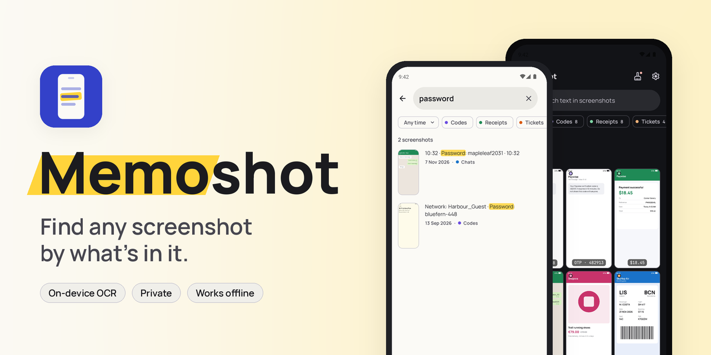</a>

 

# Memoshot

**Find any screenshot by the text inside it.** 
A private Android app that reads every screenshot on your phone, sorts it into categories, makes it searchable and helps you clear the ones you no longer need. Everything runs on the device: no account, no cloud, and it works offline.

 

 

[Overview](#-overview) · [Screenshots](#-screenshots) · [Features](#-features) · [How it works](#-how-it-works) · [Privacy](#-privacy-by-design) · [Engineering](#-engineering) · [Contact](#-contact)

---

## ✦ Overview

People take screenshots to remember things: a one-time code, a receipt, a boarding pass, a Wi-Fi password, a product they want to buy later. Then the screenshot disappears among hundreds of others, and the gallery can't search what's written inside them.

**Memoshot** fixes that. It reads the text in every screenshot **on the phone**, sorts each one into **Codes, Receipts, Tickets, Chats, Products or Other**, and lets you find it again by typing any word or number you remember. It also notices what has expired, such as used codes, past tickets and duplicates, and offers to clear it. Nothing is deleted until you confirm.

<table>
<tr>
<td width="33%" valign="top">

### 🔎 Search by text
Type `boarding`, `total` or the first digits of a code. Matches are highlighted right on the screenshot.

</td>
<td width="33%" valign="top">

### 🗂️ Sorted automatically
New screenshots are read in the background and filed into six categories, with no setup.

</td>
<td width="33%" valign="top">

### 🔒 Private and offline
Text recognition runs on the device. Screenshots and their text never leave the phone.

</td>
</tr>
</table>

<a href="assets/video/memoshot-preview.mp4">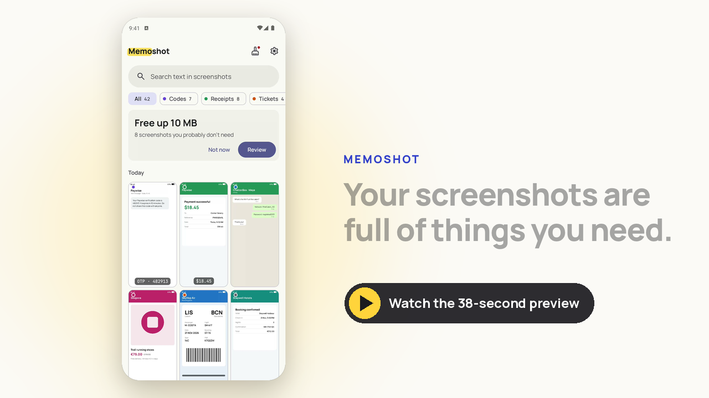</a>

The Google Play preview video (38 s, with English captions in <a href="assets/video/memoshot-preview.srt"><code>.srt</code></a>). Click to open the MP4.

---

## 📱 Screenshots

### Google Play store listing

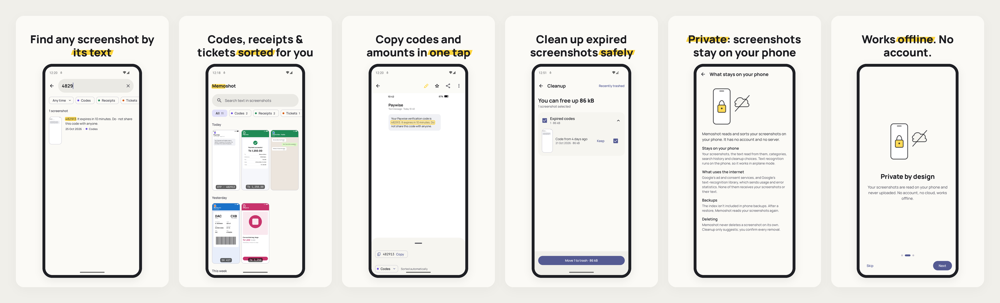

<b>View the six store screenshots at full size</b>

 

| | | |
|:-:|:-:|:-:|
| 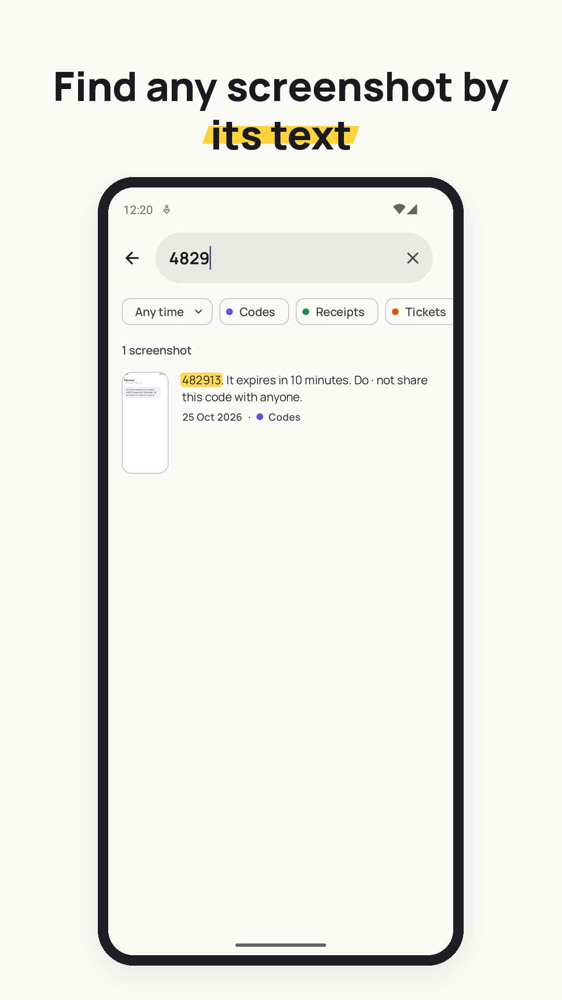 | 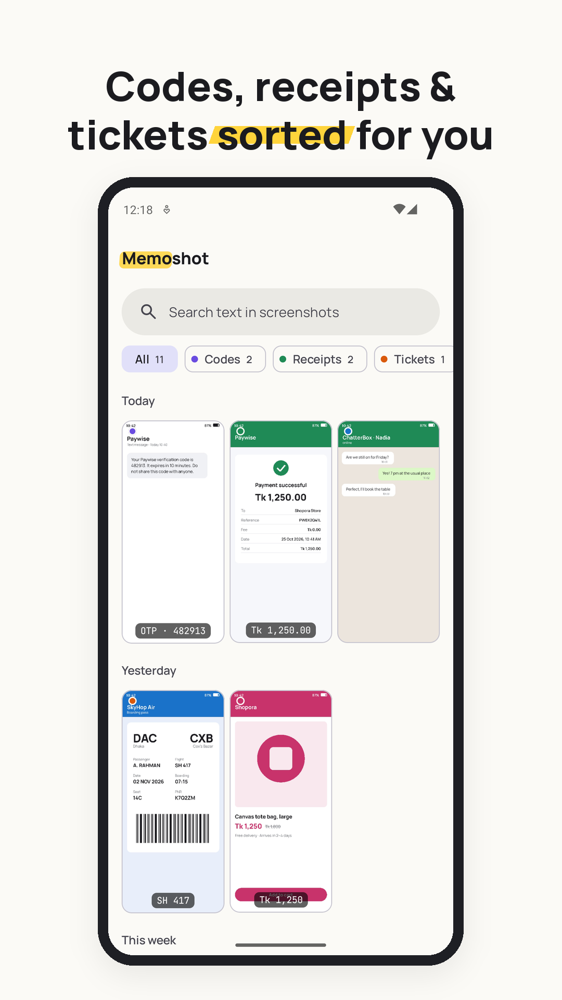 | 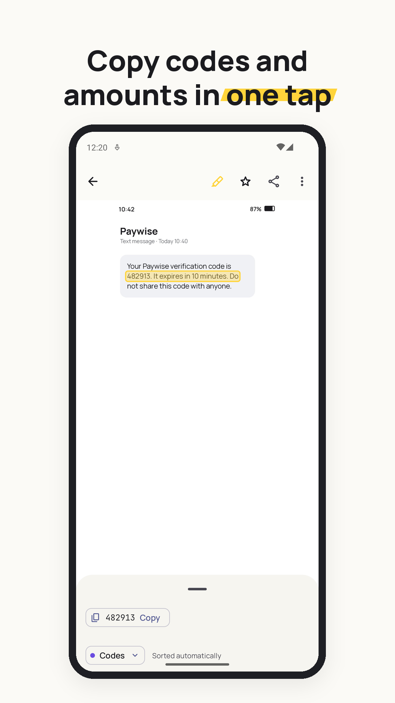 |
| **Find any screenshot by its text** | **Codes, receipts & tickets sorted for you** | **Copy codes and amounts in one tap** |
| 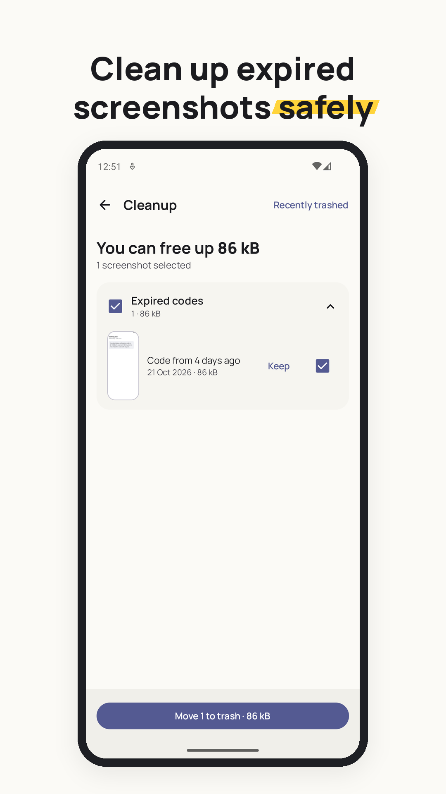 | 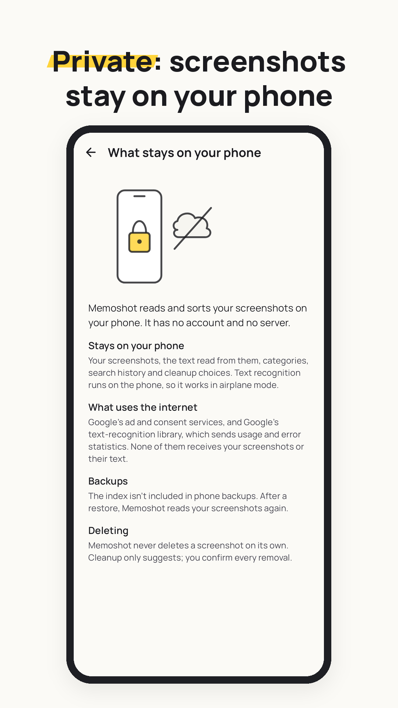 | 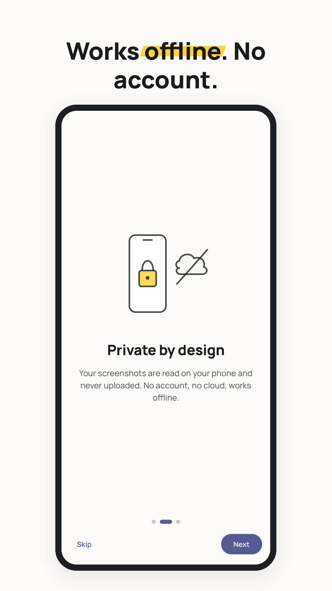 |
| **Clean up expired screenshots safely** | **Private: screenshots stay on your phone** | **Works offline. No account.** |

### Feature graphic

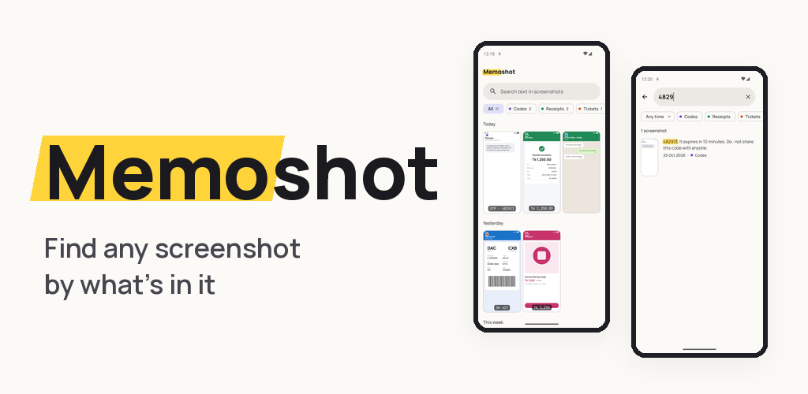

### See it in action

<table>
<tr>
<td width="36%" align="center" valign="middle">
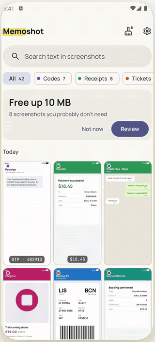
</td>
<td width="64%" valign="middle">

**Search → act → clean up, in under 30 seconds**

1. Type one word, such as `password`. Memoshot finds the chat screenshot that holds it.
2. Copy a flight number or add the date to your calendar from the detail sheet.
3. Browse by category: receipts, tickets and codes sort themselves.
4. Review expired codes and duplicates, then move them to the trash in one go. You can restore them later.

</td>
</tr>
</table>

### Dark theme

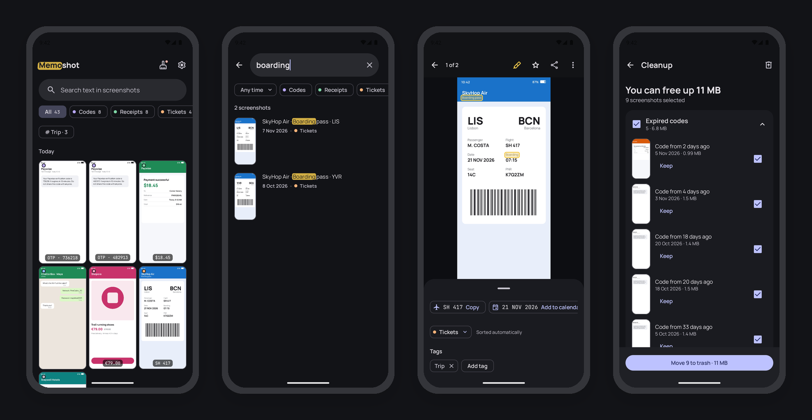

### More screens

| | | | |
|:-:|:-:|:-:|:-:|
| 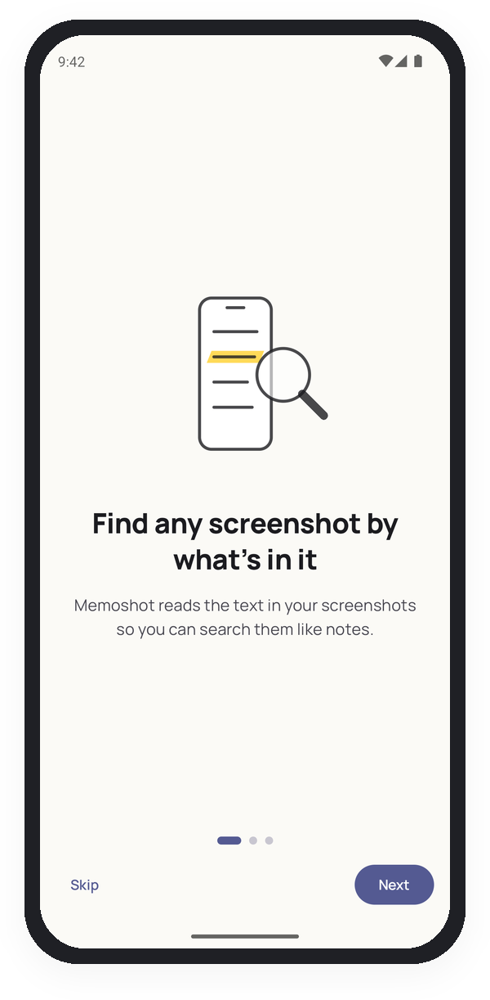 | 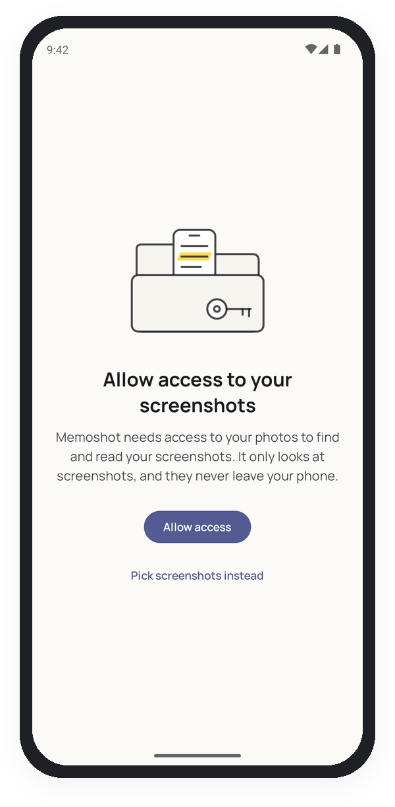 | 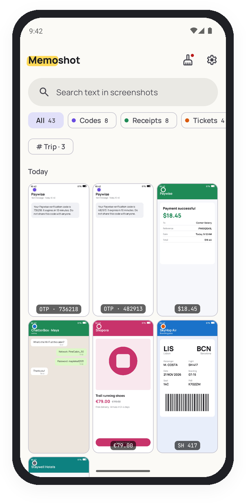 | 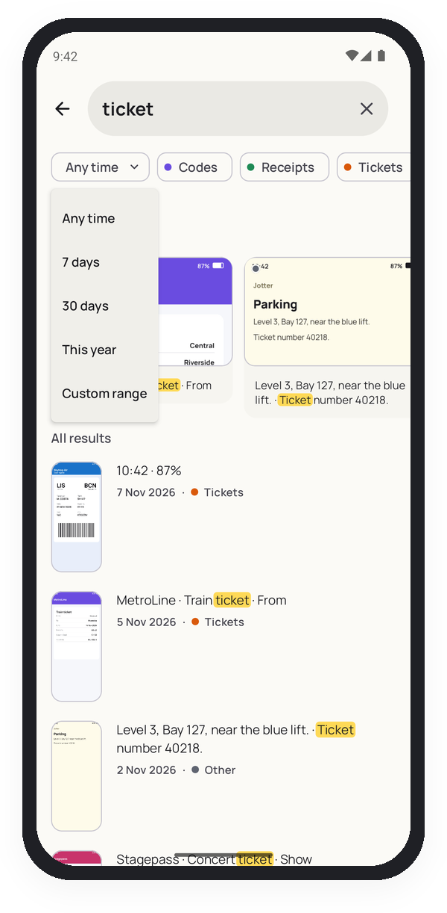 |
| Onboarding | Photo access, explained | Your own tags | Filter by date |
| 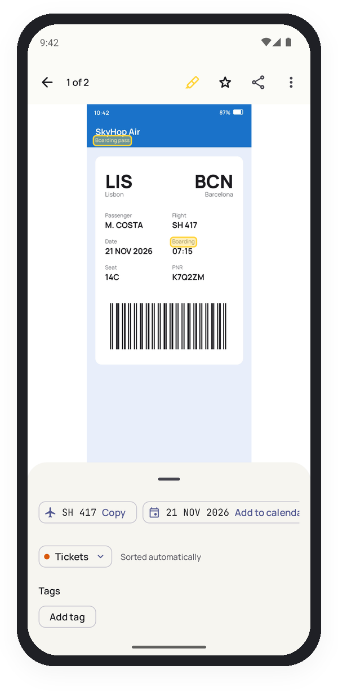 | 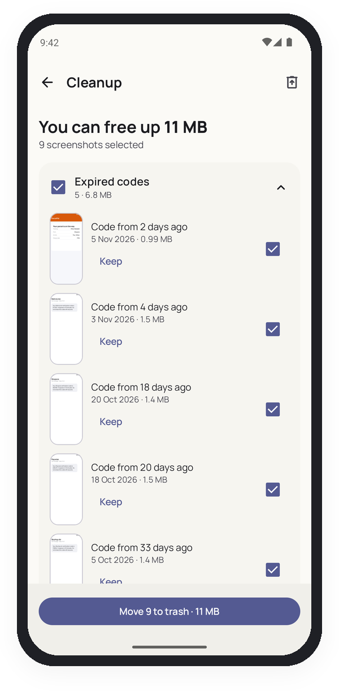 | 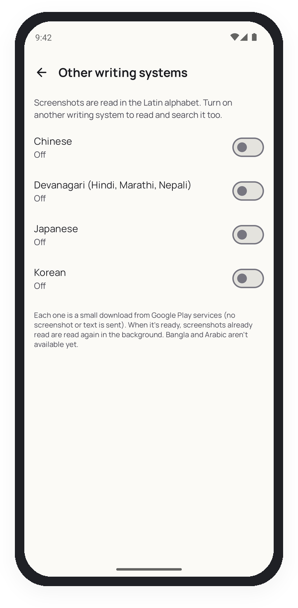 | 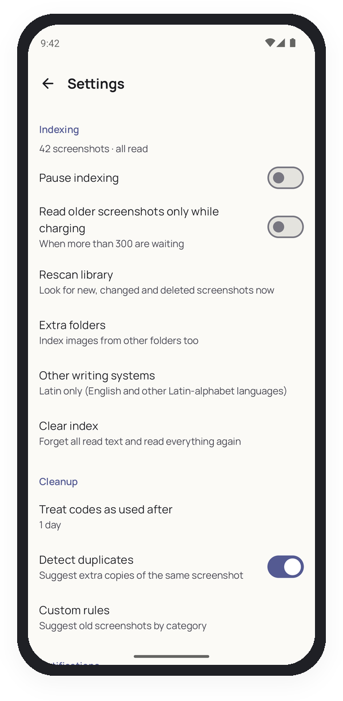 |
| Smart actions | Cleanup review | More writing systems | Settings |

> All screens use fictional sample data captured on an emulator. No real person, account or third-party app appears in them.

---

## ✨ Features

| | Feature | What it does |
|:-:|---|---|
| 🔎 | **Full-text search** | Search every word and number inside your screenshots. Results are ranked, matches are highlighted on the image, and you can filter by category, date and tag. |
| 🗂️ | **Automatic categories** | Codes · Receipts · Tickets · Chats · Products · Other. Change a category by hand any time. |
| ⚡ | **One-tap actions** | Copy a code or an amount, open a link, call a number, or add a date to the calendar, straight from the screenshot. |
| 🧹 | **Safe cleanup** | Finds used one-time codes, past tickets and duplicates, and gives the reason for each. Moves them to the system trash so they can be restored. |
| 🏷️ | **Tags** | Group screenshots your way ("Trip", "Taxes"…) and filter by tag. |
| 🔔 | **Code alert** *(optional)* | Take a screenshot of a one-time code and copy it from the notification. The alert never shows on the lock screen. |
| 🧩 | **Home-screen widget** | One tap from the launcher to search. |
| 📥 | **Share to Memoshot** | Share any image from another app to make it searchable too. |
| 🌐 | **More writing systems** | Latin-alphabet languages built in. Chinese, Devanagari, Japanese and Korean can be turned on in Settings. |
| 🔐 | **App lock** | Optional fingerprint or device-credential lock. |
| 📁 | **Extra folders and custom rules** | Index other image folders and set your own cleanup rules by category and age. |
| 📤 | **Bulk text export** | Export the recognized text of many screenshots at once. |
| 🌗 | **Material 3, light and dark** | Edge-to-edge, predictive back, large-font layouts and content descriptions throughout. |

➡️ The full tour is in **[docs/FEATURES.md](docs/FEATURES.md)**.

---

## ⚙️ How it works

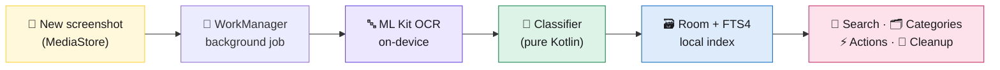

1. **Detect.** Memoshot watches the screenshot folders (and any folder you add) through MediaStore. It never scans the whole gallery.
2. **Read.** A background WorkManager job runs Google ML Kit text recognition on the device, in batches that respect battery and charging state.
3. **Understand.** A rule-based classifier written in pure Kotlin sorts the screenshot and extracts entities such as codes, amounts, dates, flight numbers, links and phone numbers. It also works out when a code or ticket has expired.
4. **Index.** The text goes into a local Room database with an FTS4 full-text index. Search normalizes the query (case, accents, digits) and ranks the results.
5. **Act.** You search, browse, tag, copy, share and clean up, all on the phone.

➡️ Architecture, data model and tech stack: **[docs/ARCHITECTURE.md](docs/ARCHITECTURE.md)**.

---

## 🔒 Privacy by design

<table>
<tr>
<td>✅ OCR, categories and search run <b>on the phone</b></td>
<td>✅ <b>No account</b>, no sign-in, no backend server</td>
</tr>
<tr>
<td>✅ <b>No analytics</b> or crash-reporting SDK</td>
<td>✅ Works fully in <b>airplane mode</b></td>
</tr>
<tr>
<td>✅ Reads only <b>screenshot folders</b> (plus folders you add)</td>
<td>✅ <b>Never deletes</b> a file without your confirmation</td>
</tr>
<tr>
<td>✅ The index is <b>excluded from cloud backups</b></td>
<td>✅ Code alerts are <b>hidden on the lock screen</b></td>
</tr>
</table>

The only network traffic comes from Google's ad and consent SDKs and ML Kit's own usage and error statistics. None of them receive your screenshots or their text. Photo access is optional: you can pick screenshots by hand instead.

➡️ Details: **[docs/PRIVACY.md](docs/PRIVACY.md)** · Privacy policy: **[memoshot.dvexo.com/privacy](https://memoshot.dvexo.com/privacy/)**

---

## 🛠️ Engineering

| | |
|---|---|
| **Language & UI** | 100% Kotlin · Jetpack Compose · Material 3 · no XML layouts |
| **Architecture** | Single `:app` module split into `core/*` and `feature/*` packages · MVVM + unidirectional data flow · Hilt |
| **Data** | Room with an FTS4 full-text index · Paging 3 · DataStore |
| **Background work** | WorkManager (no foreground services, no expedited jobs) |
| **On-device ML** | ML Kit Text Recognition v2 (Latin bundled; other scripts downloaded on demand) |
| **Performance** | Baseline Profiles · R8 full mode · 16 KB page-size aligned native libraries |
| **Platform** | minSdk 26 (Android 8.0) → targetSdk 36 · edge-to-edge · predictive back · Android 14 partial photo access |

**Quality in numbers**

| 🧪 **350+** automated tests | 🖼️ **100+** reviewed screenshot-test images | 📚 **260+** labelled OCR fixtures | 📐 **41** architecture decision records |
|:-:|:-:|:-:|:-:|
| JVM unit, Robolectric and instrumented tests | Roborazzi renders in light, dark and 2× font | A corpus that keeps the classifier accurate | Every non-obvious choice written down |

Automated guards check that no forbidden permission or network library sneaks in, that user content is never logged, and that store texts stay within Play's limits.

---

## 🗓️ Release history

| Version | Highlights |
|---|---|
| **1.3.1** | App lock prompt fix · Add tag stays above the navigation bar · steadier ad layout |
| **1.3.0** | Moved to Google's newer ads library, loaded in the background |
| **1.2.0** | Tags · home-screen widget · share to Memoshot · Chinese, Devanagari, Japanese and Korean OCR · code alerts · weekly cleanup reminder · pick screenshots by hand |
| **1.1.0** | Every feature free for everyone: extra folders, custom cleanup rules, text export |

Full notes: **[CHANGELOG.md](CHANGELOG.md)**

---

## 📬 Contact

Questions, feedback or collaboration: get in touch.

 

  

Memoshot is developed by <b>Dvexo</b>. This repository is a project showcase: it contains documentation and media, not the app's source code. 
Google Play and the Google Play logo are trademarks of Google LLC. © 2026 Dvexo. All rights reserved. See <a href="LICENSE">LICENSE</a>.

