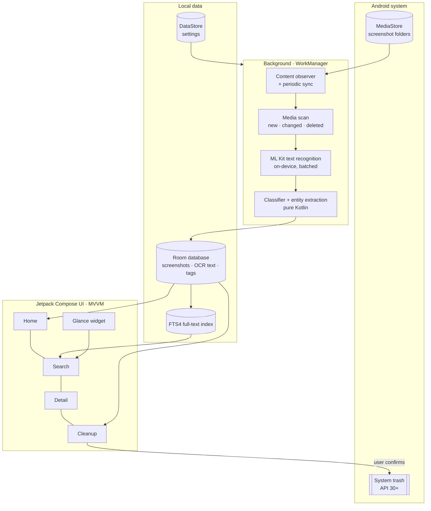

<div align="center">

# Architecture & engineering

[← Back to README](../README.md) · [Features](FEATURES.md) · [Privacy](PRIVACY.md)

</div>

---

## Goals that shaped the design

1. **Nothing leaves the device.** OCR, classification, search and cleanup all run locally. There is no backend.
2. **Works offline.** Indexing, search, categories and cleanup work in airplane mode.
3. **Respect the battery.** Background work is batched, can be deferred while charging, and never uses a foreground service.
4. **Never surprise the user.** Nothing is deleted without explicit confirmation, and every permission state is designed for.
5. **Fast and testable.** All the "intelligence" is plain Kotlin, so it runs as fast JVM unit tests.

## System overview



## Package layout

A single Gradle module, `:app`, split into packages. An architecture test enforces the boundaries: features never import other features, and `core/classify` never imports `android.*`.

```
app.memoshot
├── core
│   ├── classify      # categories, entities, expiry, duplicates, search normalization (pure Kotlin)
│   ├── ocr           # ML Kit text recognition, per-script recognizers
│   ├── media         # MediaStore queries, screenshot folder detection, trash/delete
│   ├── work          # WorkManager workers: scan, OCR batches, reminders
│   ├── database      # Room entities, DAOs, FTS4 tables, migrations
│   ├── data          # repositories
│   ├── designsystem  # theme, colors, type, shapes, components, illustrations
│   ├── notify        # code alerts and weekly reminder (lock-screen safe)
│   ├── security      # app lock (BiometricPrompt)
│   ├── prefs         # DataStore settings
│   ├── ads · pro     # consent-aware ads; build-time Pro switch
│   └── common · model
├── feature
│   ├── onboarding · permission · home · search · detail
│   ├── cleanup · trash · settings · lock
│   └── share · widget
└── navigation
```

## The indexing pipeline

| Stage | What happens | Why it's built this way |
|---|---|---|
| **Detect** | A content observer plus a periodic WorkManager sync compare MediaStore against the index: new, changed and deleted screenshots. | Survives process death and reboots; no long-running service. |
| **Read** | ML Kit Text Recognition v2 runs on-device, in small batches. Latin is bundled; Chinese, Devanagari, Japanese and Korean models are downloaded on demand. | Fully offline for the default case; the APK stays small. |
| **Understand** | A rule-based classifier scores each category from keywords, layout hints and extracted entities (codes, amounts, dates, flight numbers, URLs, phone numbers). Expiry rules mark used codes and past tickets. | Predictable, explainable and fast, and it's checked against a labelled corpus. |
| **Index** | Text is normalized (case, accents, digit groups; each CJK character becomes its own token) and stored in an FTS4 table. | Instant prefix search across thousands of screenshots on low-end phones. |
| **Present** | Paging 3 streams results into Compose. Coil 3 loads downsampled thumbnails. | Smooth scrolling with large libraries. |

## Tech stack

| Area | Choice |
|---|---|
| Language | Kotlin 2.4, coroutines and Flow |
| UI | Jetpack Compose (BOM 2026.09), Material 3, Navigation Compose |
| DI | Hilt |
| Persistence | Room 2.8 (+ FTS4), Paging 3, DataStore |
| Background | WorkManager 2.12 |
| OCR | Google ML Kit Text Recognition v2 |
| Images | Coil 3 |
| Widget | Jetpack Glance |
| Security | AndroidX Biometric |
| Ads & consent | Google Mobile Ads (Next-Gen SDK) + UMP consent |
| Build | AGP 9, Gradle version catalog, R8 full mode, Baseline Profiles |
| Testing | JUnit 4, Truth, Turbine, Robolectric, Roborazzi, AndroidX Test, UI Automator, Macrobenchmark |

All dependency versions live in one version catalog and are the latest stable releases at the time they were added.

## Quality & verification

| Check | What it covers |
|---|---|
| **Unit tests** (JVM) | Classifier, entity extraction, expiry rules, duplicates, search query building, view models. |
| **OCR fixture corpus** | 260+ labelled text samples across all categories, plus hard negatives, so classifier changes can't quietly lower accuracy. |
| **Screenshot tests** (Roborazzi) | 100+ rendered screens and states in light, dark and 2× font, reviewed image by image. |
| **Instrumented tests** | MediaStore, permissions, WorkManager, trash flows on emulators. |
| **Architecture test** | Package boundaries and the "pure Kotlin" rule for `core/classify`. |
| **Privacy guard** | Fails the build on forbidden permissions, network libraries, analytics SDKs or `android.util.Log` use. |
| **Manifest audit** | Allowlist of permissions and exported components in the merged release manifest. |
| **Release checks** | 16 KB page-size alignment of native libraries, billing presence matching the build flag, store-text length limits. |
| **Startup** | Baseline Profile generated and measured with Macrobenchmark. |

## Decisions are written down

41 Architecture Decision Records (ADRs) cover choices such as the minimum SDK, the category list, how deletion works on each Android version, the ads SDK migration and the on-demand OCR scripts. Each one records the context, the options considered and the trade-off accepted.

## Platform support

- **minSdk 26** (Android 8.0) through **targetSdk 36**
- Android 14+ partial photo access ("Selected photos")
- Edge-to-edge, predictive back, per-app themed icon
- Trash: `MediaStore.createTrashRequest` on Android 11+, a confirmed in-app delete on Android 8–10
