

# Feature tour

**Memoshot: find any screenshot by what's in it**

[← Back to README](../README.md) · [Architecture](ARCHITECTURE.md) · [Privacy](PRIVACY.md)

---

## 1. Get started in seconds

<table>
<tr>
<td width="30%">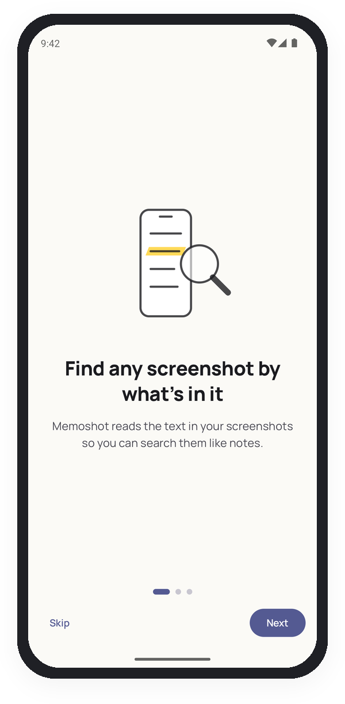</td>
<td width="30%">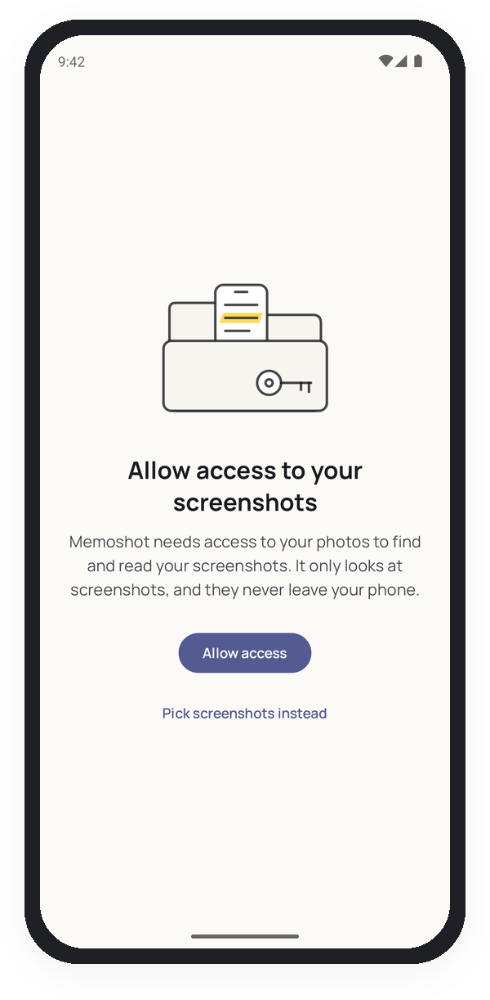</td>
<td valign="middle">

- A three-page introduction explains what the app does and how it treats your data.
- Photo access comes with a plain-language reason. Every permission state has its own screen: **full access**, Android 14+ **"Selected photos"**, **denied** and **permanently denied**.
- **No photo access?** Pick screenshots by hand. They are read the same way; new ones just aren't found automatically.
- No account and no sign-in. Indexing starts in the background straight away.

</td>
</tr>
</table>

## 2. A library that sorts itself

<table>
<tr>
<td width="30%">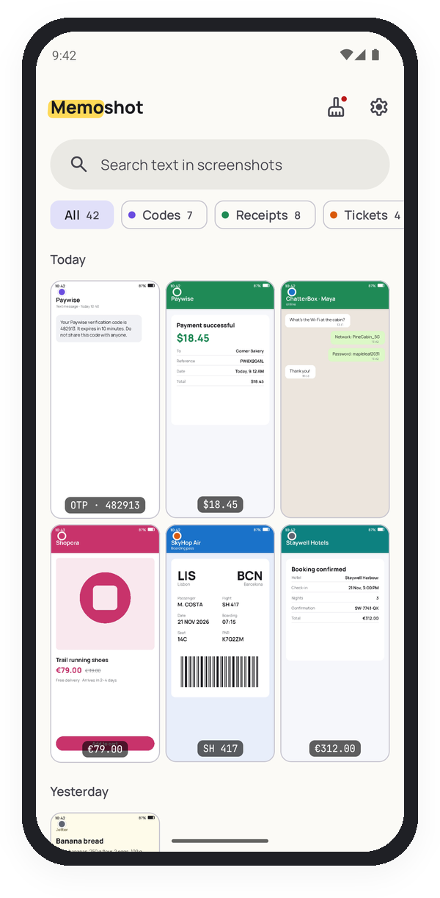</td>
<td width="30%">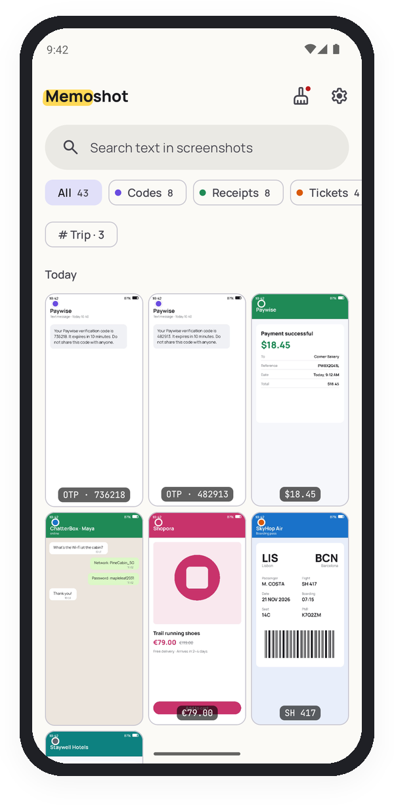</td>
<td valign="middle">

- Every new screenshot is read **in the background**, so you never have to open the app first.
- Six categories, each with its own color:  🟣 **Codes** · 🟢 **Receipts** · 🟠 **Tickets** · 🔵 **Chats** · 🩷 **Products** · ⚪ **Other**
- Thumbnails show the most useful detail at a glance, such as `OTP · 482913` or `$18.45`.
- **Tags** ("Trip", "Taxes", anything you like) group screenshots your way and can be used as filters.
- A cleanup card appears when there's space to free, and it's easy to dismiss.

</td>
</tr>
</table>

## 3. Search that reads the image

<table>
<tr>
<td width="30%">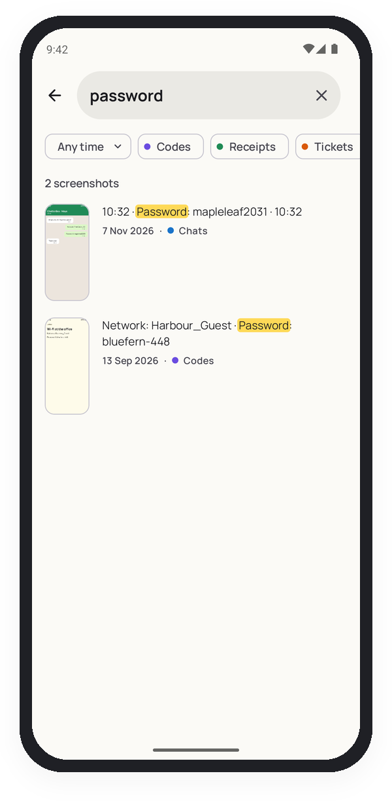</td>
<td width="30%">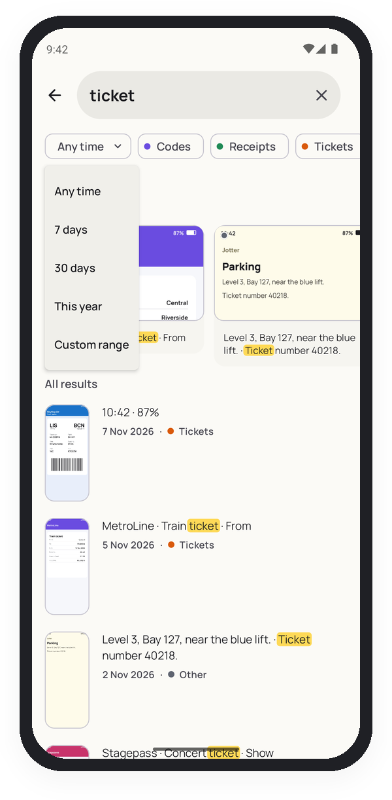</td>
<td valign="middle">

- Type any word or number you remember. Results update as you type.
- **Forgiving matching:** case, accents and spacing don't matter, and digit groups like `4821 93` or `017-1234-5678` match however you type them.
- **Top matches** first, then everything else, with the matched words highlighted.
- Filter by **category**, **date range** and **tag**.
- Recent searches stay on the device and can be cleared.
- Search from the **home-screen widget** in one tap.

</td>
</tr>
</table>

## 4. Act on what's inside

<table>
<tr>
<td width="30%">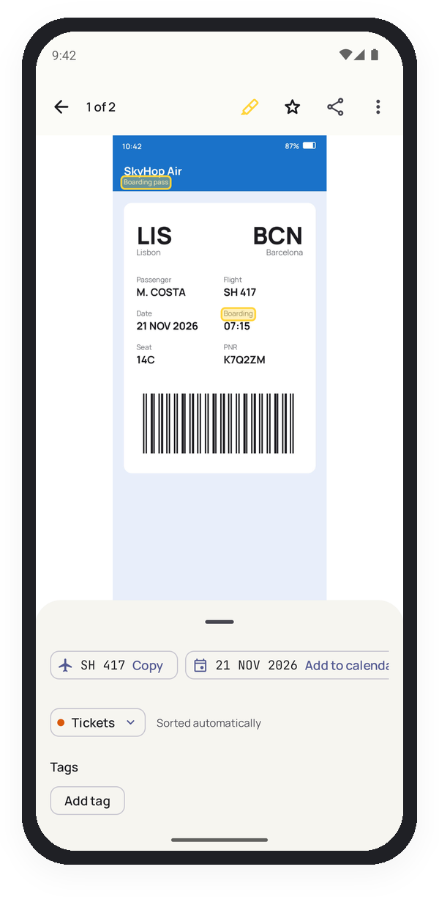</td>
<td width="30%">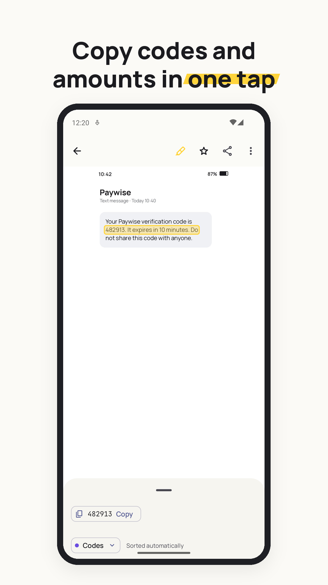</td>
<td valign="middle">

- The matched text is highlighted **on the screenshot itself**.
- **Smart actions** pulled from the text:
  - 📋 copy a one-time code, an amount or a flight number
  - 📅 add a date to the calendar
  - 🔗 open a link · 📞 call a number
- Change the category, add tags, favorite, share or open the image in another app.
- **Code alert** *(optional)*: right after you screenshot a one-time code, copy it from the notification. It never appears on the lock screen and goes away on its own.

</td>
</tr>
</table>

## 5. Clean up safely

<table>
<tr>
<td width="30%">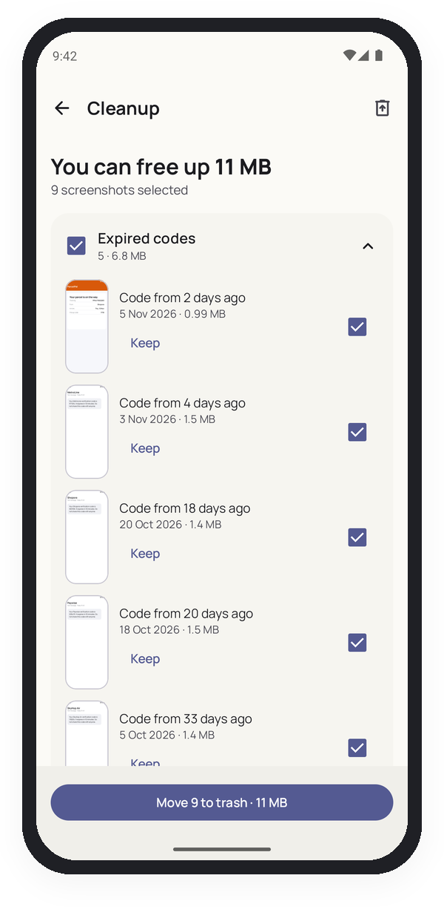</td>
<td width="30%">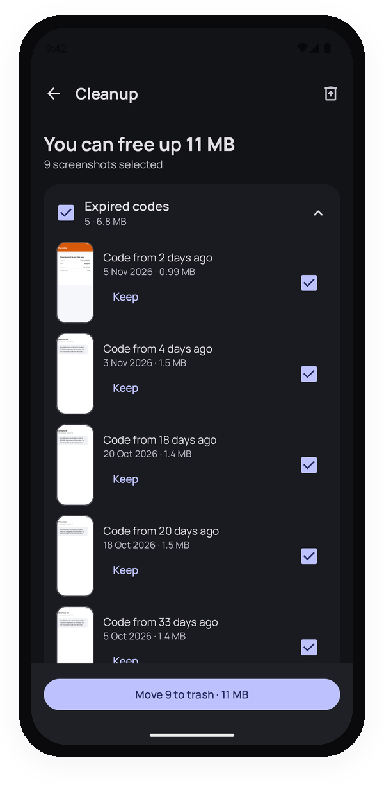</td>
<td valign="middle">

- Memoshot suggests screenshots you probably don't need, and gives the reason for each:
  - **Used one-time codes** (after a delay you choose)
  - **Past tickets** (the travel or event date has gone by)
  - **Duplicates** (extra copies of the same screenshot)
  - **Your own rules**, e.g. *"Products older than 90 days"*
- Keep any item with one tap, or review a whole group at once.
- On Android 11+ files go to the **system trash** and can be restored for about 30 days. On older versions an in-app confirmation is always shown first.
- **Nothing is ever deleted automatically.** An optional weekly reminder shows only *how many* screenshots could go, never what they contain.

</td>
</tr>
</table>

## 6. Made to fit your phone

<table>
<tr>
<td width="30%">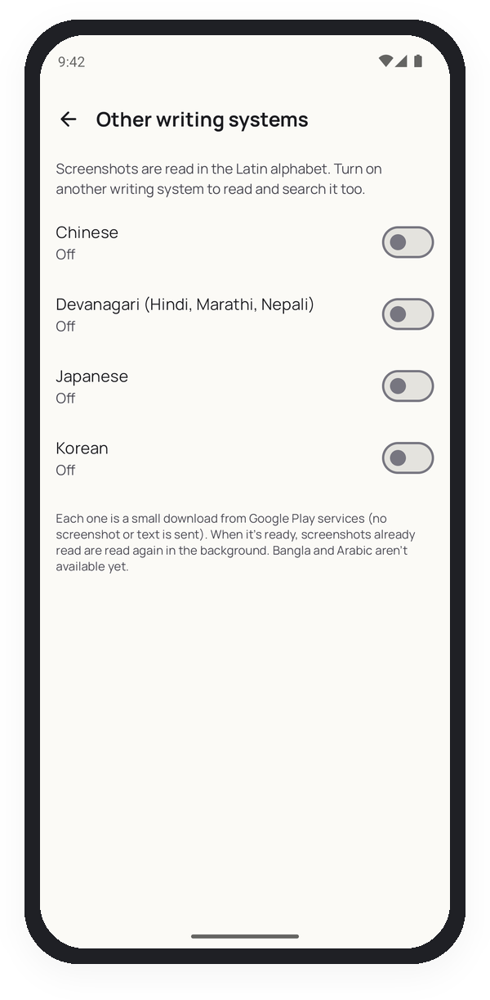</td>
<td width="30%">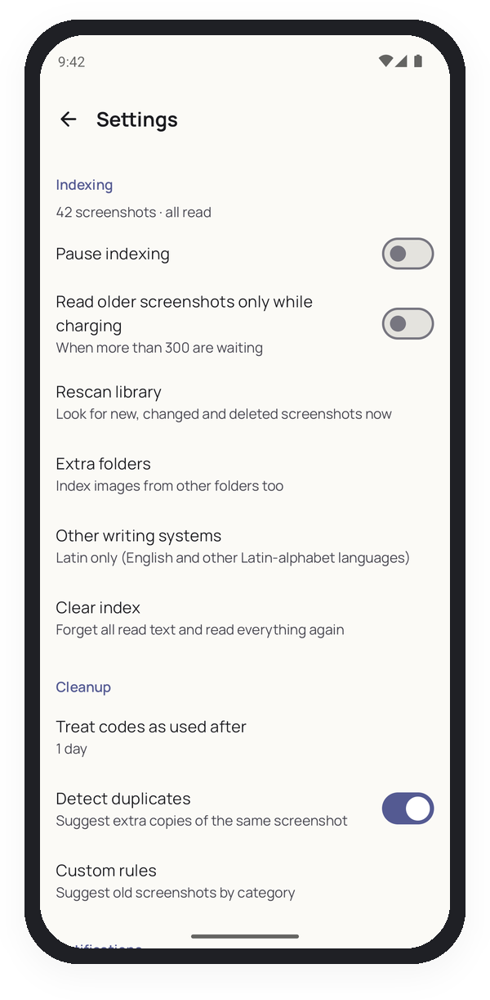</td>
<td valign="middle">

- **Languages:** English and other Latin-alphabet languages work out of the box. **Chinese, Devanagari (Hindi, Marathi, Nepali), Japanese and Korean** can be turned on in Settings; each is a small one-time download through Google Play services.
- **Battery aware:** pause indexing, or read a large backlog only while charging.
- **Extra folders:** index images outside the screenshot folders.
- **App lock** with fingerprint or the device PIN.
- **Share to Memoshot** from any app, and **export the text** of many screenshots at once.
- **Clear the index** any time to forget all recognized text.

</td>
</tr>
</table>

## 7. Light, dark and accessible

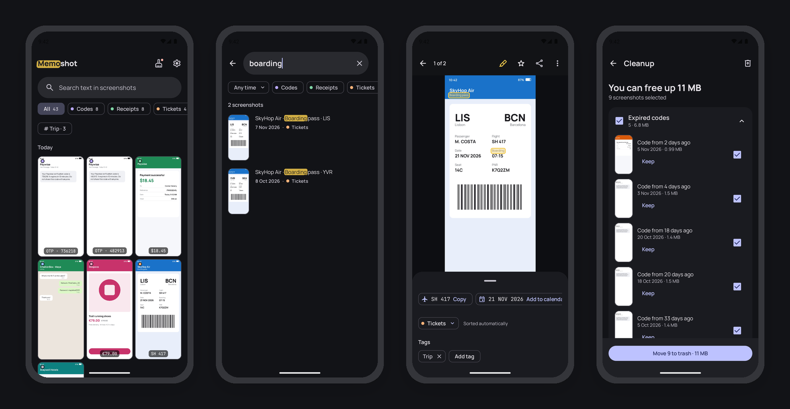

- Material 3 with a warm "paper" surface, an ink-indigo accent and a highlighter-yellow mark for matches.
- Full **dark theme**, **edge-to-edge** layout and **predictive back**.
- Tested at **2× font scale**, with content descriptions on every icon and touch targets of at least 48 dp.
- English UI; Manrope and JetBrains Mono fonts are bundled (no downloadable-font dependency).

---

