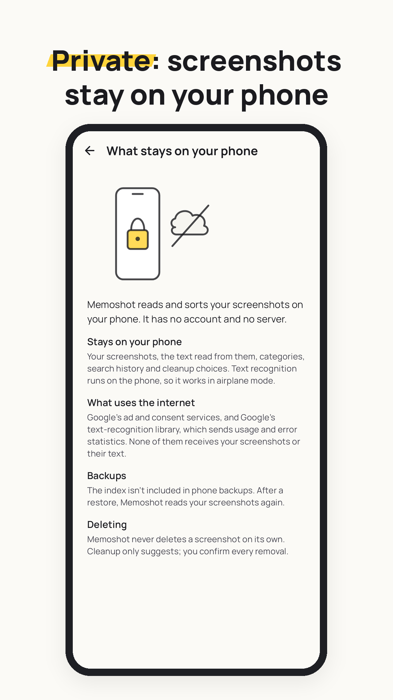
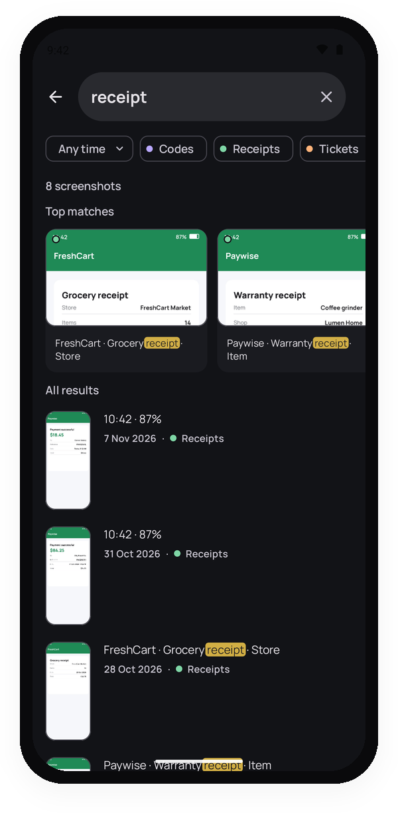

# Privacy by design

[← Back to README](../README.md) · [Features](FEATURES.md) · [Architecture](ARCHITECTURE.md)

---

Screenshots hold some of the most personal data on a phone: codes, bank receipts, chats, addresses. Memoshot is built so that this data **never has to leave the device** for the app to work.

## What stays on your phone

| Data | Where it lives |
|---|---|
| Your screenshots | Where they already are; Memoshot only reads them |
| Text recognized in them | A local database inside the app's private storage |
| Categories, tags, favorites | The same local database |
| Search history | On the device, and clearable |
| Cleanup choices | On the device |

- **No account, no sign-in, no server.**
- **No analytics** and **no crash-reporting SDK**.
- The index is **excluded from cloud backups and device transfers**. After a restore, Memoshot simply reads your screenshots again.
- **Nothing is logged** about your content: no text, file names, paths or URIs. A build-time guard enforces this.

## What uses the internet

| Component | Why | What it never receives |
|---|---|---|
| Google Mobile Ads + UMP consent | Ads that keep the app free; consent where the law requires it | Your screenshots or their text |
| ML Kit (Google) | Usage and error statistics of the on-device text recognizer | Images or recognized text |
| Google Play services | One-time download of extra OCR scripts **only if you turn them on** | Images or recognized text |

<table>
<tr>
<td width="30%"></td>
<td valign="middle">

Everything else, including indexing, search, categories and cleanup, **works in airplane mode**.

The screen on the left was captured with airplane mode on: search for `receipt` still finds every matching screenshot, because the index lives on the phone.

</td>
</tr>
</table>

## Permissions

| Permission | Used for | If you say no |
|---|---|---|
| Photos (screenshots) | Find and read new screenshots in the background | Pick screenshots by hand; they're read the same way |
| Notifications *(optional)* | Code alerts and the weekly cleanup reminder | Both features stay off |
| Biometric *(optional)* | App lock | App lock stays off |

Memoshot does **not** use: all-files access, the installed-apps list, foreground services, video or location metadata access, overlays, or accessibility services.

## Deleting is always your call

- Cleanup only **suggests**, and every removal needs your confirmation.
- On Android 11+ files go to the **system trash** and can be restored for about 30 days.
- Notifications **never show screenshot content on the lock screen**; the weekly reminder shows only a count.

---

📄 Full privacy policy: **[memoshot.dvexo.com/privacy](https://memoshot.dvexo.com/privacy/)** · Delete your data: **[memoshot.dvexo.com/delete-data](https://memoshot.dvexo.com/delete-data/)**
